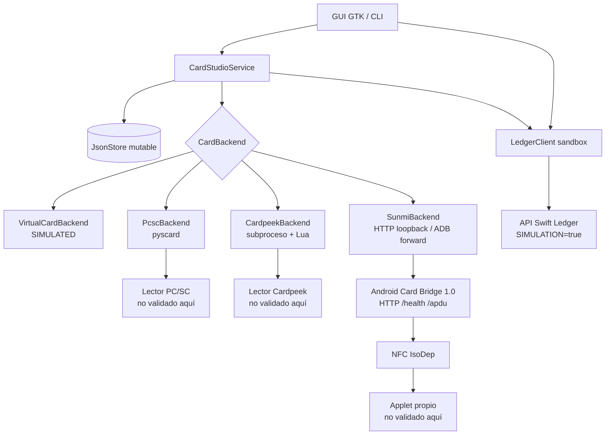
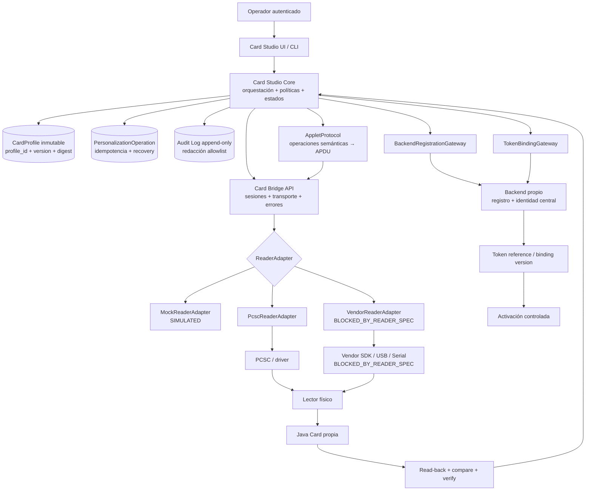
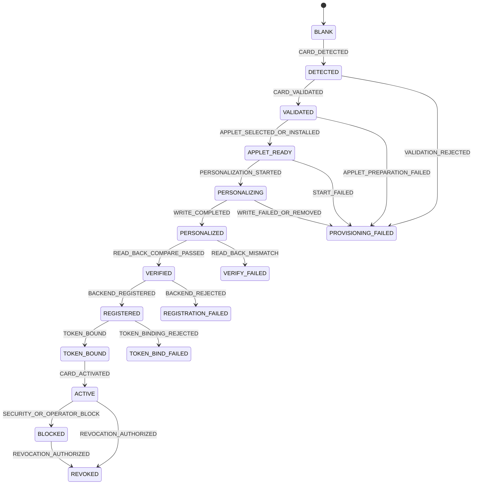

# Card Studio — Java Card Personalization & Provisioning Station

Estado de este entregable: **FASE A / ARQUITECTURA Y CONTRATOS / SIN INTEGRACIÓN FÍSICA NUEVA**.

Estado actual del producto: **SIMULATED**. Existen implementaciones de transporte y una baseline de pruebas, pero no evidencia de lector físico, Java Card física, personalización real, read-back real, registro productivo, token binding real ni activación real.

Preparación Applet/AID/APDU: **READY**. Integración PC/SC: **IMPLEMENTED / READY_FOR_HARDWARE**. Hardware Validation y dry-run están integrados en Card Studio 1.2.0; la evidencia portable se genera fuera del `.app`.

Canonical AID: **UNRESOLVED**. AID candidates: `D4534C504D4401` (PC/SC / Cardpeek) y `D4534C504D44` (Android Card Bridge). Physical validation: **PENDING_HARDWARE_CONNECTION**. Selección de Instance AID: **BLOCKED_BY_APPLET_SPEC / READY_FOR_PHYSICAL_RESOLUTION**; las demás especificaciones desconocidas del applet conservan sus bloqueos.

Definición objetivo aprobada: **Card Studio es la estación de personalización y aprovisionamiento de Java Cards propias**. Card Bridge es únicamente su capa de transporte y abstracción de hardware; no es un producto independiente ni sustituye a Card Studio.

Alcance permanente: tarjetas, perfiles, applet, identidades, backend y tokens propios. No se copian tarjetas de terceros, PAN, tracks, service codes, CVV/CVC, PIN ni credenciales bancarias.

## 1. Inventario actual de Card Studio

Repositorio inspeccionado: `/home/admin1/payment/card-studio`. Versión de aplicación declarada: `1.2.0` en `card_studio/__init__.py`.

| Componente | Evidencia actual | Reutilización prevista |
|---|---|---|
| GUI GTK4/libadwaita | `card_studio/app.py`; modos Virtual/Físico, lectura, escritura `SL-…`, recargas/cobros simulados, historial y diagnóstico | Conservar shell de UI; sustituir el flujo de cobros por Reader → Card → Profile → Operation → Verification → Registration → Activation |
| CLI | `card_studio/cli.py`; `detect`, `read`, `write`, `reload`, `charge`, `health`, `sync`, `diagnose`, `config` | Conservar diagnóstico y salida JSON; agregar operaciones semánticas de provisioning sin dispersar APDUs |
| Servicio de aplicación | `card_studio/service.py`; orquesta operaciones y reintentos sandbox | Reutilizar como frontera de aplicación, no como máquina de personalización actual |
| Modelo de tarjeta | `card_studio/model.py`; `CardState`, `Operation`, validación `SL-…`, saldo MXN y APDUs propietarios | Conservar solo como baseline legacy; el modelo objetivo separa hardware, OS, applet, identidades y token |
| Backends de tarjeta | `card_studio/backends.py`; contrato `CardBackend`, implementaciones virtual, Cardpeek y SUNMI | Migrar gradualmente detrás de Card Bridge/ReaderAdapter; no añadir condicionales de fabricante al core |
| PC/SC | `card_studio/pcsc.py`; ReaderAdapter Linux/macOS con `listReaders`, `connect`, `waitForCard`, `getATR`, `transmit`, `selectApplet`, `disconnect` y errores físicos | **IMPLEMENTED / READY_FOR_HARDWARE**; ausencia física pendiente, sin capacidades inferidas |
| Persistencia | `card_studio/store.py`; JSON atómico, archivos `0600`, historial limitado a 100 operaciones | Conservar escritura atómica para configuración; no usar el historial mutable como auditoría append-only |
| Configuración | `card_studio/config.py`; URL, terminal, transporte y lector en `settings.json`, sin llave | Separar application/reader/profile/backend/security config en la transición |
| Cliente backend sandbox | `card_studio/ledger.py`; HMAC-SHA256, timestamp, nonce e idempotency key; exige `simulation=true` | Reutilizar patrones de canonicalización e idempotencia; no reutilizar el endpoint sandbox como registro real |
| Diagnóstico | `card_studio/diagnostics.py`; versión, plataforma, PC/SC, Cardpeek, ADB, rutas y API opcional | Base para evidencia de discovery; una salida `OK` no equivale a capability física validada |
| Logs | RotatingFileHandler, 1 MB y tres respaldos | Requieren política allowlist/redacción y modelo de eventos antes de provisioning |
| Pruebas | `tests/`; 50 pruebas locales: 24 baseline + AID/APDU, PC/SC, dry-run, evidencia, migración y packaging | **50/50 PASS**; mocks nunca equivalen a DEVICE/CARD/E2E físico |
| Empaquetado | `packaging/macos/`, `.github/workflows/tests.yml`, `run.sh` | Conservar; registrar versiones de todos los componentes en cada operación |

El `Operation` actual sí conserva una llave idempotente al reintentar sincronización, pero representa una operación sandbox, no una `PersonalizationOperation` física.

## 2. Inventario actual de Card Bridge

### Android Card Bridge

| Elemento | Evidencia actual |
|---|---|
| Identidad | Paquete `mx.admin1.cardbridge`; `versionName=1.0`, `versionCode=1` |
| Plataforma | `minSdkVersion=23`, `targetSdkVersion=28`; NFC opcional en el manifest |
| Comunicación con Card Studio | HTTP en `127.0.0.1:5380`; `GET /health` y `POST /apdu` |
| Comunicación con tarjeta | NFC Reader Mode + `IsoDep`; selección de applet y `transceive` serializado con lock |
| Sesión | Una `IsoDep currentCard`; timeout de tarjeta 6000 ms y de socket 8000 ms |
| Seguridad declarada | Loopback, `allowBackup=false`, `debuggable=false`, `usesCleartextTraffic=false` |
| Metadata disponible | `/health` devuelve servicio, modelo Android y disponibilidad de lector |
| Empaquetado | `android/build.sh` compila Java 8, genera/verifica APK y usa un keystore de depuración externo |
| Artefactos | Existen APK y archivos de build en `android/build/`; su presencia no prueba instalación ni ejecución física |

### Cliente SUNMI dentro de Card Studio

`SunmiBackend` en `card_studio/backends.py` consume el puente mediante `adb forward`, health y transporte APDU. Es código de integración real, pero no se obtuvo evidencia física en esta fase.

### Funciones ausentes en Card Bridge actual

No existen `enumerateReaders`, `openReader`, `closeReader`, metadata ATR/capacidades, `session_id`, reader/adapter version en health, reset semántico, presencia durante toda la operación, evidencia de desconexión estable, operaciones de banda ni un contrato de errores de transporte completo.

Los dos valores se conservan como candidatos en `card_studio/applet.py`: `D4534C504D4401` (PC/SC / Cardpeek) y `D4534C504D44` (Android Card Bridge). El SELECT calcula `Lc=07` y `Lc=06` respectivamente. Cardpeek recibe el SELECT desde Python; el build Android genera `AppletAid.java` desde el mismo registro. Ninguno se declara Instance AID canónico. Estado: **READY_FOR_PHYSICAL_RESOLUTION** mediante Hardware Validation; no se ejecutó SELECT físico porque Rocketek no está conectado.

## 3. Qué componentes son mock o simulados

| Componente/prueba | Naturaleza simulada |
|---|---|
| `VirtualCardBackend` | Estado y saldo locales; no hay tarjeta |
| `FakeReader` / `FakeConnection` en `tests/test_pcsc.py` | Respuestas APDU programadas; no hay PC/SC ni tarjeta física |
| `FakeLedger` en `tests/test_service.py` | Registro/fallos en memoria; no hay backend |
| `SandboxHandler` en `tests/test_ledger.py` | Servidor HTTP local que siempre declara `simulation=true` |
| Mock de diagnóstico | Sustituye el backend PC/SC y la detección de ejecutables |
| Recargas/cobros GUI/CLI | Simulación explícita de saldo MXN, no fondos ni cobros |
| Estado `RECORDED` actual | Confirmación de API sandbox, no registro de una Java Card real |
| Compatibilidad física mostrada por UI | La etiqueta sigue diciendo `SIMULACIÓN`; no es evidencia de dispositivo |

No se ejecutaron lectores, tarjetas, ADB, backend remoto ni personalización durante esta inspección.

## 4. Qué componentes son reales y cuál es su evidencia

“Real” en esta sección significa **código ejecutable no mock**, no validación física.

| Componente | Implementación real | Evidencia disponible | Nivel que sí puede afirmarse |
|---|---|---|---|
| GUI/CLI | Código GTK/argparse | Suite local | Funcionalidad de aplicación baseline |
| Persistencia JSON | Escritura atómica y permisos | Pruebas de reinicio/configuración | Persistencia local baseline |
| PC/SC Linux/macOS | Llamadas `pyscard`, selección y transmit | Fakes en pruebas | Adaptador implementado; **DEVICE_VALIDATED no afirmado** |
| Cardpeek | Subproceso y script Lua | Sin prueba física aportada | Transporte implementado; no validado |
| SUNMI/Card Bridge | HTTP loopback + Android NFC IsoDep | Código y APK; sin ejecución física en esta fase | Transporte implementado; no validado |
| HMAC e idempotencia sandbox | Criptografía estándar y nonce | Prueba HTTP local | Integridad cliente sandbox; no autenticación de tarjeta |
| Android controles | Manifest y servidor loopback | Revisión de fuente | Configuración presente; no evaluación de seguridad |
| Diagnóstico | Enumeración PC/SC/ADB cuando se invoca | Prueba simulada | Herramienta reusable; no capability discovery completo |

Estados físicos reservados: `DEVICE_VALIDATED`, `CARD_VALIDATED`, `PROVISIONING_VALIDATED`, `BACKEND_VALIDATED` y `END_TO_END_VALIDATED` requieren evidencias posteriores independientes.

## 5. Diagrama actual



El core actual conoce `CardBackend`, saldo y operaciones sandbox. No existe una máquina de estados de personalización ni una separación completa entre transporte, protocolo de applet y orquestación.

## 6. Diagrama objetivo



Responsabilidades estrictas:

- **Card Studio:** operador, perfiles, workflow, identidad lógica, políticas, verificación, backend, token, recuperación y auditoría.
- **Card Bridge:** API estable, descubrimiento/sesión y transporte; no decide perfiles, identidad, tokens ni activación.
- **ReaderAdapter:** traduce el contrato común al transporte del lector; ninguna peculiaridad de fabricante entra al core.
- **AppletProtocol:** encapsula comandos del applet propio sin mezclarlos con SDK del lector.
- **Backend:** identidad central, registro, autenticación y resolución/rotación de tokens.
- **Java Card:** applet, datos personalizados y material criptográfico protegido según sus capacidades reales.

## 7. Gap analysis

| Área | Baseline | Gap para el objetivo | Dependencia/estado |
|---|---|---|---|
| Producto | Sandbox de saldo y `SL-…` | Estación de personalización Java Card propia | Diseño aprobado; implementación pendiente |
| Reader discovery | ReaderAdapter PC/SC y selección Rocketek/explícita | Evidencia de identidad/conexión física | READY_FOR_HARDWARE; DEVICE_VALIDATED pendiente |
| Capacidades | No existe objeto | Capacidades UNKNOWN/SUPPORTED/UNSUPPORTED + evidencia | BLOCKED_BY_READER_SPEC para hardware concreto |
| Sesión | Sesión PC/SC implementada; `currentCard` en Android | `session_id`, presencia, timeout, operación y cierre estable | Adapter listo; evidencia física pendiente |
| ATR/metadata | `getATR()` implementado | ATR, protocolo y capacidades sin inferencias | READY_FOR_HARDWARE; ATR real pendiente |
| AID/applet | Dos candidatos centralizados y validador read-only | Instance AID confirmado por tarjeta | **READY_FOR_PHYSICAL_RESOLUTION**; canónico UNRESOLVED |
| Perfil | Configuración global simple | `CardProfile` versionado, inmutable y con digest | Puede diseñarse sin hardware |
| Identidad | `SL-…` editable localmente | `card_id` propio, central, único y estable | Requiere contrato backend |
| Identidad criptográfica | HMAC de terminal, no de tarjeta | Generación/política de claves y public identity | BLOCKED_BY_APPLET_SPEC + política |
| Applet lifecycle | Solo selección/APDUs propietarios | Install/select/personalize/status/version/read-back | SELECT listo; resto BLOCKED_BY_APPLET_SPEC |
| Personalización | Escritura de ID sin workflow | Operación estricta, idempotente y autorizada | Diseño propuesto |
| Read-back | Lectura general, no comparación de provisioning | Comparación de identidad, perfil, configuración, clave pública y estado | Requiere applet real |
| Máquina de estados | `PENDING`/`RECORDED` sandbox | Estados y errores completos sin saltos | Puede implementarse antes del hardware |
| Operador | No existe | Autenticación, sesión, permisos y workstation | BLOCKED_BY_OPERATOR_SPEC |
| Backend registration | Operaciones sandbox | Registro de tarjeta verificada, único e idempotente | Contrato propuesto; implementación backend pendiente |
| Token binding | No existe | Binding versionado y separado de `card_id` | Contrato propuesto; servicio pendiente |
| Autenticación de tarjeta | Identificador estático | Challenge-response criptográfico | BLOCKED_BY_APPLET_SPEC |
| Auditoría | Historial JSON actualizable | Eventos append-only, correlación y evidencia sanitizada | Nuevo modelo |
| Redacción | Evidencia allowlist sin campos sensibles | Política APDU completa antes de provisioning | Implementada para Hardware Validation |
| Recuperación | Retry de sync sandbox | SAFE_TO_RETRY / REQUIRES_READ_BACK / REVIEW / NON_RETRYABLE | Nueva máquina de recuperación |
| Versionado | App `1.2.0`, bridge `1.0` | Adapter/profile/applet/backend API por operación | App/build/plataforma/arquitectura ya en evidencia |
| UI | Hardware Validation y dry-run integrados | Etapas, bloqueos, verificación, registro y activación | Validación lista; flujo completo después de state machine |
| Banda | Ausente | Perfil separado; solo estructuras internas propias | BLOCKED_BY_READER_SPEC; no implementar ahora |
| Evidencia | JSON portable con versión, plataforma, ATR, intentos y conclusión | Evidencia física real | Harness listo; archivo físico PENDING |
| Pruebas | 24 unitarias/simuladas | UNIT/INTEGRATION/DEVICE/CARD/BACKEND/E2E | Matriz de la sección 16 |

## 8. ReaderAdapter contract — PROPOSED

El contrato es semántico y no depende de fabricante. Los nombres pueden mapearse a la implementación existente durante Fase B/C sin cambiar su significado.

### Objetos de frontera

```text
ReaderInfo
  reader_id: stable identifier assigned to the physical reader
  display_name
  connection_type: PCSC | USB | SERIAL | ADB_FORWARD | VENDOR_SDK | MOCK
  manufacturer: string | UNKNOWN
  model: string | UNKNOWN
  firmware_version: string | UNKNOWN
  adapter_name
  adapter_version

CardInfo
  card_presence: PRESENT | ABSENT | UNKNOWN
  atr: bytes | UNAVAILABLE              # no identity principal
  protocol: string | UNKNOWN
  card_environment: string | UNKNOWN    # no asumir Java Card por ATR
  observed_at

ReaderSession
  session_id
  reader_id
  operation_id
  card_presence_state
  started_at
  timeout
  status: OPEN | CLOSED | ABORTED | EXPIRED
```

### Capacidades con evidencia

Un booleano sin procedencia es insuficiente. Cada capacidad usa:

```text
CapabilityValue
  state: UNKNOWN | SUPPORTED | UNSUPPORTED
  source: OFFICIAL_DOC | SDK | DEVICE_QUERY | PHYSICAL_TEST | NONE
  evidence_reference
  observed_at
  adapter_version
```

`ReaderCapabilities` contiene `chip_read`, `chip_write`, `contactless_read`, `contactless_write`, `magnetic_read`, `magnetic_write`, `secure_pin`, `sam_support`, `pcsc` y `vendor_sdk`. Una operación que exige una capacidad solo puede ejecutarse con `SUPPORTED` y evidencia aceptada para la fase. `UNKNOWN` bloquea; nunca se interpreta como soporte.

### Contrato mínimo

```text
ReaderAdapter
  enumerateReaders() -> list[ReaderInfo]
  openReader(reader_id, operation_id, timeout) -> ReaderSession
  closeReader(session_id) -> CloseEvidence
  getDeviceStatus(reader_id) -> DeviceStatus
  resetDevice(reader_id) -> ResetEvidence
  getCapabilities(reader_id) -> ReaderCapabilities

  detectCard(session_id) -> CardInfo
  connectCard(session_id) -> CardConnection
  disconnectCard(session_id) -> DisconnectEvidence
  getCardInfo(session_id) -> CardInfo
  cardPresent(session_id) -> CardPresence
  transmitCommand(session_id, command, sensitivity) -> CommandResult

  readMagneticData(session_id) -> BLOCKED_BY_READER_SPEC
  writePermittedMagneticData(session_id, own_profile_data) -> BLOCKED_BY_READER_SPEC
```

Reglas del contrato:

1. `openReader` no implica tarjeta presente; `detectCard` no implica Java Card compatible.
2. `transmitCommand` transporta; no instala applet ni cambia estados del core.
3. `sensitivity` controla redacción; el payload APDU no se registra por defecto.
4. Pérdida de presencia o conexión genera `CARD_REMOVED`/error tipado y aborta; nunca completa la operación.
5. Timeout tras enviar un comando con efecto devuelve resultado `UNCERTAIN`, clasificado `REQUIRES_READ_BACK`; no reintento automático.
6. `closeReader`/`disconnectCard` deben producir evidencia incluso en rutas de error.
7. `MockReaderAdapter` declara `connection_type=MOCK` y evidencia `SIMULATED` en todas sus salidas.
8. No se implementan comandos de banda, USB, serial o SDK hasta disponer de especificación oficial.

## 9. CardProfile model — PROPOSED

```text
CardProfile
  schema_version
  profile_id
  profile_version                 # inmutable para cada revisión
  profile_digest                  # identidad exacta del contenido
  card_type                       # únicamente tipos propios autorizados
  supported_card_environments     # sin inferencias; validados por fase CARD
  applet_ref
    applet_name
    applet_version
    package_aid: BLOCKED_BY_APPLET_SPEC
    instance_aid: BLOCKED_BY_APPLET_SPEC
    artifact_digest: BLOCKED_BY_APPLET_SPEC
  allowed_features
  chip_profile
  key_policy
    generation: ON_CARD_PREFERRED | CONTROLLED_IMPORT | UNSPECIFIED
    private_key_export: FORBIDDEN
    public_identity_format: BLOCKED_BY_APPLET_SPEC
    destruction_policy: BLOCKED_BY_SECURITY_POLICY
  tokenization_policy
    policy_id
    policy_version
    binding_required: true
    activation_requires_verified_registration: true
  magnetic_profile               # separado y opcional; solo datos propios
    enabled: false
    format_reference: BLOCKED_BY_READER_SPEC
  lifecycle_policy
    allowed_initial_states
    revocation_policy
    retry_policy
  personalization_plan_ref       # operaciones semánticas, no SDK del lector
  verification_plan_ref
  status: DRAFT | APPROVED | RETIRED
```

Invariantes:

- `profile_id + profile_version + profile_digest` se conserva en la operación y en read-back.
- Un perfil `DRAFT` no habilita personalización física.
- Un cambio de contenido crea nueva versión/digest; no reescribe el historial.
- Ningún perfil contiene PAN de terceros, Track 1/2 copiado, service code replicado, CVV/CVC o claves privadas en claro.
- AID, comandos, estructura de banda y capacidades criptográficas quedan bloqueados hasta especificación y prueba.

## 10. PersonalizationOperation model — PROPOSED

```text
PersonalizationOperation
  personalization_operation_id     # UUID/identificador único estable
  idempotency_key                  # = personalization_operation_id
  parent_operation_id              # recuperación, si aplica
  operator_id
  operator_session_id
  workstation_id
  reader_id
  reader_session_id
  card_id                          # reservado centralmente; nunca PAN/track
  physical_card_reference          # referencia operativa, no identidad secreta
  profile_id
  profile_version
  profile_digest
  applet_version
  card_studio_version
  card_bridge_version
  reader_adapter_version
  backend_api_version
  state
  requested_at
  started_at
  completed_at
  verification_result_ref
  registration_reference
  token_binding_reference
  result: PENDING | SUCCEEDED | FAILED | UNCERTAIN | CANCELLED
  recovery_class
  failure_code
  evidence_manifest_ref
```

Reglas:

1. Crear la orden y reservar `card_id` son pasos previos auditables; la reserva no significa tarjeta registrada ni activa.
2. El backend usa `idempotency_key` para impedir dos identidades lógicas por la misma operación.
3. Reintentar la misma orden conserva ID, `card_id`, perfil y llave; una orden nueva nunca se usa para ocultar un resultado incierto.
4. Toda mutación conserva estado anterior, estado nuevo, timestamp, actor y evidencia.
5. `SUCCEEDED` solo es válido en `ACTIVE`; escritura exitosa no es éxito de la operación completa.
6. `UNCERTAIN` exige reconciliación antes de cualquier repetición con efectos.

## 11. State machine completa — PROPOSED

`BLANK` es el estado administrativo de entrada declarado para una tarjeta propia candidata; no prueba por sí solo que el chip esté vacío. `VALIDATED` exige comprobar compatibilidad y condición real.



Eventos de verificación: `VERIFY_STARTED` ocurre al entrar en la actividad posterior a `PERSONALIZED`; `PERSONALIZATION_VERIFIED` es la evidencia que permite llegar a `VERIFIED`. No se salta directamente de escritura a registro.

| Transición | Evidencia mínima | Acción bloqueada hasta cumplir |
|---|---|---|
| BLANK → DETECTED | Sesión, lector, presencia, timestamp | Selección de perfil como candidato final |
| DETECTED → VALIDATED | ATR/metadata disponible, compatibilidad y capacidad | Preparación de applet |
| VALIDATED → APPLET_READY | Package/instance/version y selección o instalación verificada | Personalize |
| APPLET_READY → PERSONALIZING | Perfil aprobado, operador autorizado, identidad reservada | Comandos con efecto |
| PERSONALIZING → PERSONALIZED | Resultado de cada escritura, sin asumir verificación | Register/Activate |
| PERSONALIZED → VERIFIED | Read-back y comparación completa | Registration |
| VERIFIED → REGISTERED | Respuesta backend idempotente y referencia | Token binding |
| REGISTERED → TOKEN_BOUND | Binding versionado asociado a la misma tarjeta/registro | Activation |
| TOKEN_BOUND → ACTIVE | Autorización y comprobación de estado final | Uso controlado |

Recuperación y errores:

- `PROVISIONING_FAILED`, `VERIFY_FAILED`, `REGISTRATION_FAILED` y `TOKEN_BIND_FAILED` conservan el último estado físico conocido y el resultado `FAILED` o `UNCERTAIN`.
- `CARD_REMOVED`, desconexión o timeout incierto aborta y exige read-back/revisión; nunca vuelve silenciosamente a `BLANK`.
- Reintentar lectura puede ser `SAFE_TO_RETRY`. Repetir escritura tras respuesta perdida es `REQUIRES_READ_BACK`. Conflicto de identidad/registro es `REQUIRES_OPERATOR_REVIEW`. Una operación marcada `NON_RETRYABLE` por política no se repite.
- La recuperación crea una referencia `parent_operation_id` solo después de determinar el estado real.
- `BLOCKED` y `REVOKED` no regresan automáticamente a `ACTIVE`; cualquier excepción requiere política y autorización explícitas.

Bloqueos de UI:

```text
PERSONALIZE = reader_connected AND card_present AND profile_valid
              AND applet_ready AND operator_authorized AND identity_reserved
VERIFY      = PERSONALIZED and no uncertain operation unresolved
REGISTER    = VERIFIED
BIND TOKEN  = REGISTERED
ACTIVATE    = VERIFIED AND REGISTERED AND TOKEN_BOUND
```

## 12. Backend registration contract — PROPOSED

Las rutas son ilustrativas y no describen endpoints existentes. Deben versionarse y revisarse con el backend antes de implementar.

### Reserva previa de identidad

```text
POST /api/v1/card-identity-reservations
Idempotency-Key: <personalization_operation_id>

{
  "operation_id": "...",
  "profile_id": "...",
  "profile_version": "...",
  "operator_id": "...",
  "workstation_id": "...",
  "requested_at": "..."
}

200/201
{
  "card_id": "JC-000000184",
  "reservation_id": "...",
  "status": "RESERVED",
  "api_version": "v1"
}
```

La reserva es central e idempotente. No prueba existencia física ni autoriza activación. `JC-000000184` es solo ejemplo de formato, no un consecutivo asignado.

### Registro posterior a verificación física

```text
POST /api/v1/card-registrations
Idempotency-Key: <personalization_operation_id>

{
  "card_id": "JC-000000184",
  "reservation_id": "...",
  "card_profile": {
    "profile_id": "...",
    "profile_version": "...",
    "profile_digest": "..."
  },
  "applet_version": "...",
  "public_identity": {
    "algorithm": "BLOCKED_BY_APPLET_SPEC",
    "public_key_reference": "...",
    "fingerprint": "..."
  },
  "reader_reference": {
    "reader_id": "...",
    "adapter_version": "..."
  },
  "personalization_operation_id": "...",
  "software_version": {
    "card_studio": "...",
    "card_bridge": "...",
    "reader_adapter": "..."
  },
  "timestamp": "...",
  "verification_result": {
    "status": "PERSONALIZATION_VERIFIED",
    "evidence_digest": "..."
  }
}

201
{
  "registration_id": "...",
  "card_id": "JC-000000184",
  "status": "REGISTERED",
  "api_version": "v1"
}
```

Requisitos: operador autenticado, transporte autenticado, autorización por permiso, unicidad de `card_id`, validación del digest de evidencia, misma llave idempotente en reintentos y respuesta repetida coherente. `REGISTRATION_CONFLICT` exige revisión, no otra identidad.

Nunca enviar private/session/master keys, PIN, secretos de autenticación, APDUs sensibles ni datos de tarjetas de terceros. La clave pública o su referencia no es una clave privada.

## 13. Token binding contract — PROPOSED

`card_id`, identidad criptográfica, registro y token son entidades distintas. El token operativo puede rotar/revocar/reemplazar sin cambiar `card_id`.

### Autenticación activa previa

```text
POST /api/v1/card-authentication-challenges
{
  "registration_id": "...",
  "operation_id": "..."
}

201 { "challenge_id": "...", "challenge": "...", "expires_at": "..." }
```

Card Studio envía el challenge a la Java Card mediante operaciones semánticas y devuelve únicamente la respuesta pública necesaria. El backend verifica con la identidad registrada. Ningún identificador estático sustituye esta prueba.

### Binding

```text
POST /api/v1/card-token-bindings
Idempotency-Key: <personalization_operation_id>

{
  "card_id": "JC-000000184",
  "registration_id": "...",
  "challenge_id": "...",
  "authentication_result": "VERIFIED",
  "tokenization_policy_id": "...",
  "tokenization_policy_version": "...",
  "operation_id": "...",
  "timestamp": "..."
}

201
{
  "binding_id": "...",
  "binding_version": 1,
  "card_id": "JC-000000184",
  "token_reference": "...",
  "status": "TOKEN_BOUND",
  "api_version": "v1"
}
```

El backend resuelve el token; Card Studio conserva `token_reference`, no material secreto. Rotación crea nueva `binding_version` y mantiene historial. Revocar un token no revoca automáticamente la identidad física; revocar una tarjeta sí exige bloquear sus bindings según política.

`TOKEN_BIND_FAILED` impide activación. Un timeout después de solicitar binding se consulta por ID/idempotency key, no se repite a ciegas.

## 14. Audit model — PROPOSED

### Evento append-only

```text
AuditEvent
  event_id
  sequence
  event_type
  timestamp
  personalization_operation_id
  operator_id
  operator_session_id
  workstation_id
  reader_id
  reader_session_id
  card_id: nullable
  profile_id + profile_version + profile_digest
  card_studio_version
  card_bridge_version
  reader_adapter_version
  backend_api_version
  previous_state + new_state
  result
  error_code: nullable
  evidence_reference
  previous_event_hash
  event_hash
```

El hash encadenado es una medida propuesta de integridad, no sustituye almacenamiento append-only, control de acceso ni respaldo. El backend puede ser la fuente central; la copia local conserva correlación y recuperación.

Eventos mínimos: `READER_CONNECTED`, `CARD_DETECTED`, `CARD_VALIDATED`, `PROFILE_SELECTED`, `APPLET_SELECTED`, `PERSONALIZATION_STARTED`, `PERSONALIZATION_COMPLETED`, `VERIFY_STARTED`, `VERIFY_PASSED`, `BACKEND_REGISTERED`, `TOKEN_BOUND`, `CARD_ACTIVATED`, `VERIFY_FAILED`, `DEVICE_ERROR`, `CARD_REMOVED`, `OPERATOR_CANCELLED`, `BACKEND_FAILED`, `TOKEN_BIND_FAILED`, `CARD_BLOCKED` y `CARD_REVOKED`.

### Política de redacción

- Serialización por **allowlist** de campos, no por borrado oportunista.
- No registrar private keys, session keys, master keys, raw secrets, authentication secrets, PIN ni APDU payloads sensibles.
- No registrar PAN, Track 1/2, CVV/CVC ni datos de terceros aunque aparezcan en una entrada accidental.
- Guardar referencias, fingerprints públicos y digests de evidencia cuando sean suficientes.
- Excepciones y stack traces pasan por el mismo redactor; no se registra el cuerpo de requests por defecto.
- La evidencia exportada declara `evidence_level`: `SIMULATED`, `DEVICE_VALIDATED`, `CARD_VALIDATED`, `PROVISIONING_VALIDATED`, `BACKEND_VALIDATED` o `END_TO_END_VALIDATED`.

Artefactos por fase: `hardware_detect.json`, `reader_capabilities.json`, `card_detection.json`, `personalization_result.json`, `verification_result.json`, `registration_result.json`, `token_binding_result.json` y `activation_result.json`, todos con schema/version, IDs, timestamps, resultado y sin secretos.

## 15. Error model — PROPOSED

```text
CardStudioError
  code
  stage
  message                        # seguro para operador
  operation_id
  reader_id: nullable
  card_id: nullable
  retry_class
  outcome: CERTAIN_FAILURE | UNCERTAIN
  evidence_reference
  sanitized_details
```

Códigos mínimos y comportamiento:

| Código | Etapa | Recuperación |
|---|---|---|
| READER_NOT_FOUND / READER_BUSY | Discovery/open | Revisar conexión; lectura SAFE_TO_RETRY |
| READER_UNSUPPORTED / CAPABILITY_UNKNOWN | Preflight | Bloquear; obtener especificación/evidencia |
| CARD_NOT_PRESENT / CARD_REMOVED | Sesión | Abortar; si había efecto, REQUIRES_READ_BACK |
| CARD_UNSUPPORTED | Validación | NON_RETRYABLE con ese perfil |
| CARD_COMMUNICATION_ERROR | Transmit | Según efecto; timeout posterior = UNCERTAIN |
| APPLET_NOT_FOUND | Preparación | No instalar sin perfil/artefacto aprobado |
| APPLET_VERSION_MISMATCH | Validación | Revisión; no actualizar implícitamente |
| PERSONALIZATION_FAILED | Escritura | Conservar evidencia; read-back antes de repetir |
| VERIFY_FAILED | Read-back | No registrar; revisión o recuperación controlada |
| OPERATOR_UNAUTHORIZED | Autorización | NON_RETRYABLE hasta nueva autorización |
| BACKEND_UNAVAILABLE | Registro/binding | Consultar/reintentar según certeza e idempotencia |
| REGISTRATION_CONFLICT | Registro | REQUIRES_OPERATOR_REVIEW |
| TOKEN_BIND_FAILED | Binding | No activar; reconciliar binding |
| PROFILE_INVALID | Preflight | Bloquear hasta perfil aprobado |
| EVIDENCE_INCOMPLETE | Cualquier transición | No avanzar de estado |

Se conservan códigos baseline útiles (`NO_READER`, `READER_NOT_FOUND`, `INCOMPATIBLE_CARD`, etc.) mediante mapeo, sin romper pruebas existentes. “Something went wrong” nunca es la única evidencia.

## 16. Test matrix

### Baselines que no se degradan

- Card Studio, este repositorio: **24/24 unittest PASS** en Ubuntu local. Son pruebas unitarias/simuladas, no hardware.
- SUNMI V3 Cobros, repositorio separado: typecheck/build y **88/88 PASS** documentados para un working tree sandbox en `docs/G2_VALIDACION_LINEA_BASE.md`. Esa baseline no pertenece a Card Studio y no se modifica en esta fase.
- Ninguna de esas baselines demuestra SUNMI física, lector real, Java Card, TLS remoto, BRIX, adquirentes, token binding ni activación.

| Nivel | Alcance | Evidencia requerida | PASS / FAIL esencial |
|---|---|---|---|
| UNIT | Perfiles, estados, errores, redacción, idempotencia, versionado, verificación por comparación | Casos y resultados deterministas | Estados inválidos/saltos, secretos o duplicados = FAIL |
| CONTRACT | ReaderAdapter y gateways con contratos compartidos | Request/response, errores, timeouts y compatibilidad | Capacidad UNKNOWN aceptada o contrato ambiguo = FAIL |
| INTEGRATION | Core + Card Bridge + MockReaderAdapter + stores + backend fake | Flujo completo etiquetado SIMULATED | Registro sin read-back o activación sin binding = FAIL |
| RECOVERY | Card removed, timeout antes/después de efecto, crash y respuesta perdida | Estado recuperado y auditoría | Reescritura ciega o doble identidad = FAIL |
| DEVICE | ReaderAdapter físico, driver/SDK, open/close repetido, presencia | `hardware_detect.json`, capacidades, estabilidad | Solo si identidad/conexión/capacidades son reales |
| CARD | Java Card propia, metadata, entorno/applet, disconnect | `card_detection.json` | Sin personalización en el primer checkpoint CARD |
| PROVISIONING | Escritura controlada + read-back + compare | Resultados y digest de perfil/applet | Cualquier diferencia o ausencia de evidencia = FAIL |
| BACKEND | Registro real controlado, conflictos, replay e idempotencia | `registration_result.json` | Duplicado, secreto o registro no verificado = FAIL |
| TOKEN | Challenge-response, binding, rotación y revocación | `token_binding_result.json` | Token separado de identidad y sin activación prematura |
| END-TO-END | Operador → lector → tarjeta → verify → registro → token → activación | Manifiesto de evidencias y versiones | Solo entonces `END_TO_END_VALIDATED` |

Toda prueba física usa únicamente tarjetas propias de prueba. Los mocks nunca se convierten en evidencia DEVICE/CARD/E2E. Cada fase conserva resultados negativos y rollback.

## 17. Datos pendientes del lector

Todos los elementos siguientes están **BLOCKED_BY_READER_SPEC** hasta recibir documentación y, cuando corresponda, prueba física:

- fabricante y modelo exacto;
- revisión de hardware y firmware;
- tipo de conexión y comportamiento de enumeración;
- sistemas operativos soportados;
- driver oficial, dependencias e instalación;
- SDK oficial, versión, licencia y documentación;
- soporte PC/SC y limitaciones;
- protocolo de comandos, framing, timeouts y recuperación;
- identificadores estables de dispositivo y reader;
- chip contact: lectura/escritura y alcance real;
- contactless: lectura/escritura y alcance real;
- compatibilidad Java Card y ATR/metadata disponibles;
- lectura/escritura de banda y formatos permitidos;
- secure PIN y SAM;
- reset, card presence y desconexión limpia;
- manejo de tarjeta retirada, busy, desconexión y respuesta perdida;
- capacidades queryables vs capacidades solo documentales;
- requisitos de alimentación, pairing, permisos y seguridad;
- procedimiento de prueba controlada y rollback.

Dependencias separadas:

- **BLOCKED_BY_APPLET_SPEC / READY_FOR_PHYSICAL_RESOLUTION:** Instance AID entre dos candidatos; el comando físico ya está preparado y no modifica código automáticamente.
- **BLOCKED_BY_APPLET_SPEC:** Package AID, artifact/digest, OS/runtime, lifecycle GlobalPlatform si aplica, APDUs semánticas más allá de SELECT, almacenamiento, algoritmos, generación de claves, public identity, contadores, estados y read-back.
- **BLOCKED_BY_BACKEND_SPEC:** endpoints reales, autenticación/autorización, reserva de identidad, registros, tokens, challenges, errores, idempotencia y ambientes.
- **BLOCKED_BY_OPERATOR_SPEC:** identidad de operador, sesiones, roles, permisos, workstation y aprobaciones.
- **BLOCKED_BY_SECURITY_POLICY:** custodia, importación/destrucción de claves, retención, evidencia, revocación y recuperación.

No se reemplaza ninguno de estos bloqueos por valores de demostración.

## 18. Plan de transición sandbox → real

Regla global: cambios mínimos, una fase por entrega, pruebas dirigidas + suite completa, evidencia y rollback. No refactor amplio para acomodar un lector. El frente Applet/AID/APDU quedó preparado dentro de B/C, sin iniciar personalización, backend ni activación.

| Fase | Trabajo | Evidencia de salida / criterio de avance |
|---|---|---|
| A — Arquitectura y contratos | Este inventario, diagramas, gaps, modelos y matriz | Revisión/aprobación del responsable; dependencias marcadas; sin código físico |
| B — Card Bridge abstraction | Introducir contrato estable y compatibilidad para transports existentes | Contract tests; baseline intacta; ningún SDK nuevo |
| C — Reader Adapter mock | `MockReaderAdapter`, capacidades UNKNOWN/SUPPORTED y escenarios de fallo | Flujo SIMULATED explícito; contract tests negativos |
| D — State machine real | Perfiles, operaciones, estados, operador, auditoría, redacción y recuperación en core | UNIT/INTEGRATION/RECOVERY PASS; imposible activar sin evidencias |
| E — Backend registration | Reserva/registro idempotente en ambiente controlado | BACKEND_VALIDATED solo con backend real controlado; mocks quedan SIMULATED |
| F — Token binding | Challenge-response, binding, rotación/revocación en ambiente controlado | Binding versionado; activación todavía bloqueada si falta tarjeta real |
| G — Reader Adapter físico | Análisis documental y adapter del modelo exacto | **Checkpoint 1:** device identity, conexión, capacidades, driver/SDK, open/close y presencia → DEVICE_VALIDATED |
| H — Java Card física | Sesión y metadata básica con tarjeta propia | **Checkpoint 2:** detección, sesión, entorno/applet y clean disconnect; sin personalizar → CARD_VALIDATED |
| I — Personalización real | Perfil/applet aprobados y operación controlada | Escritura propia autorizada; todavía no ACTIVE |
| J — Read-back verification | Comparación completa y recuperación de fallos | **Checkpoint 3:** write → read-back → compare → verify → PROVISIONING_VALIDATED |
| K — End-to-end controlado | Registro + token + activación de tarjeta física verificada | **Checkpoints 4 y 5:** registro/binding y ACTIVE solo dentro del ecosistema controlado → END_TO_END_VALIDATED |

Orden de implementación mínimo para B–D, sujeto a aprobación posterior:

1. Añadir nuevos contratos y pruebas sin retirar `CardBackend`.
2. Adaptar PC/SC/SUNMI mediante wrappers; no cambiar el core por fabricante.
3. Introducir modelos y store append-only separado del historial sandbox.
4. Implementar state machine y MockReaderAdapter con evidencia SIMULATED.
5. Migrar UI por estados y bloqueos, manteniendo la baseline hasta tener paridad de regresión.
6. Solo después conectar contratos backend y, con especificación completa, hardware.

Punto de detención actual: **SOFTWARE_READY=YES; HARDWARE_READY=YES; PHYSICAL_VALIDATION=PENDING**. Card Studio 1.2.0 incluye ReaderAdapter, candidatos, SELECT builder/parser, SW handling, UI Hardware Validation, dry-run y evidencia. La ejecución sin lector produjo `HARDWARE_NOT_CONNECTED`; 50/50 pruebas PASS. Solo falta conectar Rocketek CSCR3, insertar Java Card de desarrollo y ejecutar `./scripts/validate_applet_hardware` o **Run Validation** en la app. No se ejecutó SELECT físico, instalación de applet, escritura de banda, personalización, registro, token binding ni activación.
